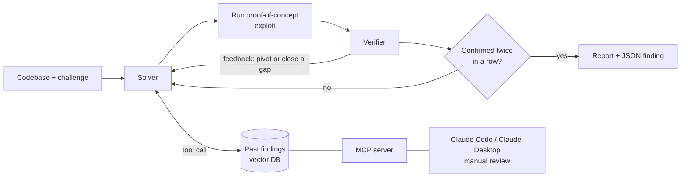

# Audit Agent: Overview

An autonomous multi-agent LLM system that finds and verifies smart contract vulnerabilities. Built in Python on the Claude API, with agentic RAG over past audit findings and an MCP server for manual reviews.

> This repository is a write-up, not runnable code. The source is kept private because it is in active use for audit contests and bug bounties. A full code walkthrough is available on request.

## What it does

Given a codebase and a description of what counts as a valid exploit, the agent searches for a vulnerability, builds a concrete attack scenario, and keeps refining it until an independent reviewer (a sub AI agent) confirms it or the run's budget is used up.

## Architecture



## How the loop works

1. **Solver** studies the code and proposes an attack scenario.
2. The Solver also writes a **proof-of-concept exploit**, which is run and checked.
3. **Verifier**, a separate reviewer with its own instructions, checks the Solver's reasoning against the result of the run.
4. The Verifier's feedback tells the Solver either to **pivot** to a new idea (the reasoning is wrong) or to **close a specific gap** (the idea is right but incomplete).
5. A finding is accepted only after **two consecutive passing reviews**. Runs stop after a set number of iterations or failures.

## Knowledge base (RAG)

The Solver can search 265 public Sherlock audit reports for similar past bugs.

```
265 PDF reports → extracted text → 3,110 overlapping chunks (with metadata)
→ local embeddings (nomic-embed-text via Ollama) → Chroma vector DB (cosine similarity)
```

- **Search by meaning:** a query like *"callback before balance update"* finds reentrancy-style findings even when the word "reentrancy" doesn't appear.
- **Agentic RAG:** search is given to the Solver as a tool it decides when to call, not text pasted into its prompt. It can be turned on or off per run to compare results.
- **MCP server:** the same search runs as a Model Context Protocol server, so I can look up precedents during my own manual reviews from Claude Code or Claude Desktop.
- **Local and free:** embeddings are computed on my machine, so no data leaves it.

## Engineering

- **Structured output:** each confirmed finding is also saved as schema-validated JSON (title, severity, location, attack steps, impact, confidence) using a forced tool call.
- **Cost:** prompt caching of the large codebase context, so later calls cost about 0.1x; token and cache usage logging.
- **Reliability:** retries with back-off on rate limits and server errors, automatic fallback to another model, and checkpoint/resume of the full conversation state.
- **Scale:** several agents can run in parallel on one target and stop as soon as one confirms a finding.
- **Flexibility:** swappable prompt sets per language (Solidity, C++).
- **Security:** runs in a sandboxed Docker container (non-root user, minimal privileges, target code mounted read-only, API key injected at runtime).

## Tech stack

Python · Claude API (tool calling, structured outputs, prompt caching, streaming) · RAG · Ollama · nomic-embed-text v1.5 · Chroma · MCP · Docker

## Results

- Tested on live audit contests against real-world codebases.
- Benchmark results (find rate with and without RAG, cost per run) will be added here.

## Author

Elena Petreska · [GitHub](https://github.com/EPetreska) · [LinkedIn](https://linkedin.com/in/elena-petreska)
